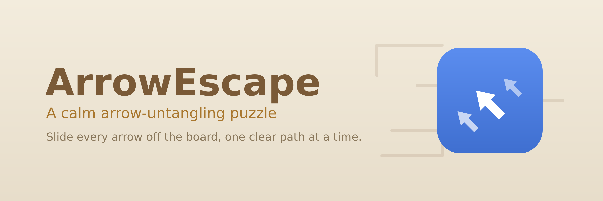
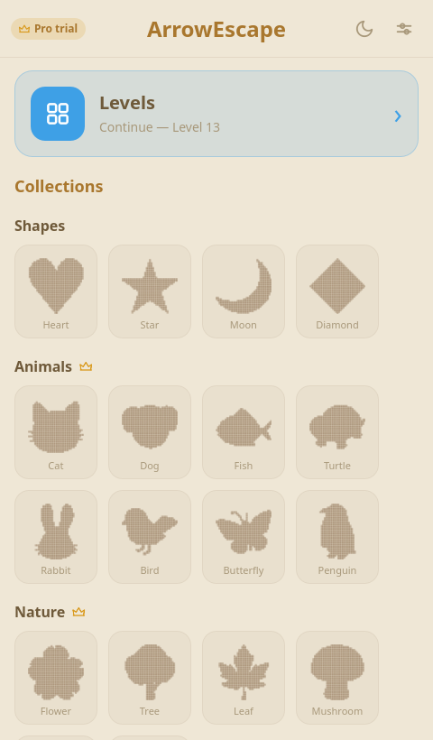
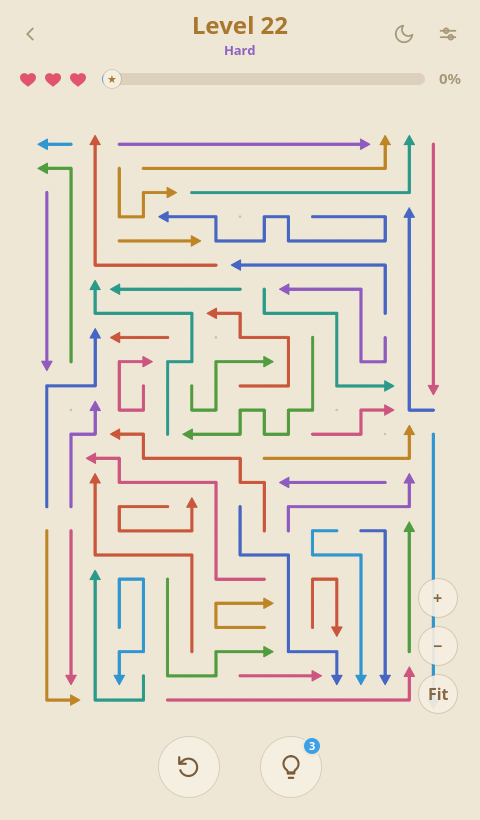
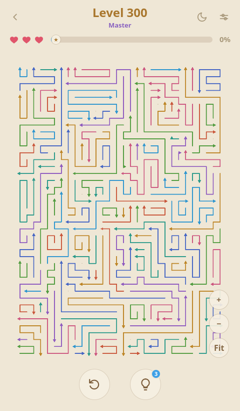
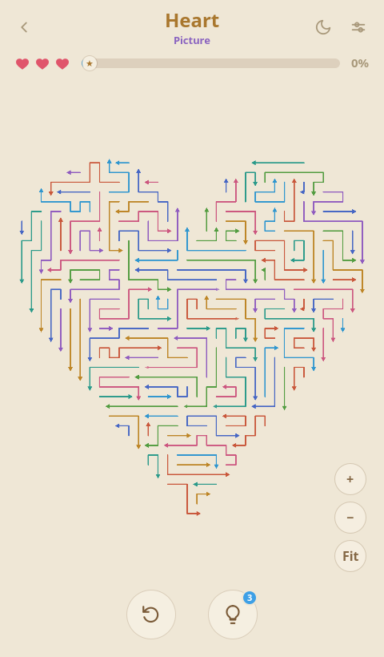
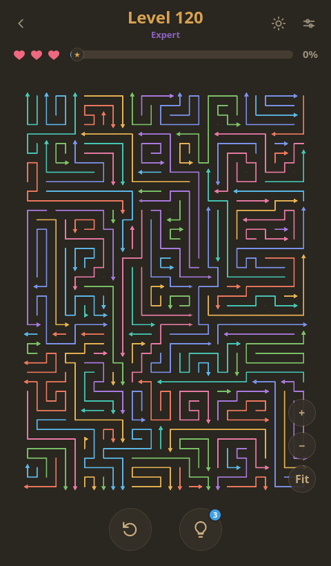
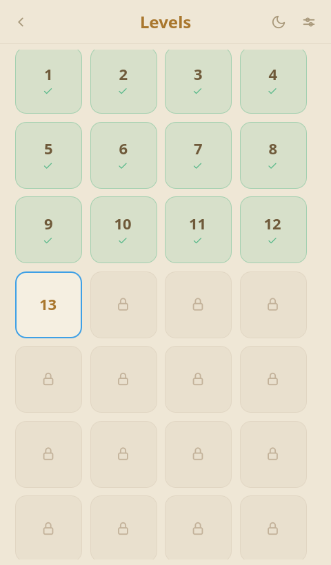

<p align="center">
  
</p>

<p align="center">
  A calm <b>slide-the-arrows-off-the-board</b> puzzle for the desktop. Every arrow points a
  direction: click one to slide it off the board, but only if its whole lane to the edge is
  clear. Blocked clicks cost a life; clear the board to win. Pure move-order logic, no
  timer, and every level is solvable by construction.
</p>

<p align="center">
  <a href="https://snapcraft.io/arrowescape"></a>
</p>

<table>
  <tr>
    <td width="33%"></td>
    <td width="33%"></td>
    <td width="33%"></td>
  </tr>
  <tr>
    <td width="33%"></td>
    <td width="33%"></td>
    <td width="33%"></td>
  </tr>
</table>

## Install

**Snap**:

```sh
sudo snap install arrowescape
```

Built with **Qt 6 Quick (QML) + C++20 / CMake**.

## Architecture

```
CMakeLists.txt          # project, Qt, app-id, QML module
src/
  main.cpp              # QGuiApplication + QQmlApplicationEngine (AE_SHOT screenshot hook)
  AppInfo.h.in          # configured app-id / name / version
  core/
    ArrowBoard.*        # all game logic: list model of arrows, tap/collision,
                        #   hearts, win/lose, and the solvable-by-construction
                        #   level generator
  qml/
    Main.qml            # window, top bar, sounds, win/lose overlay
    Theme.qml           # calm palette singleton (light/dark)
    Board.qml           # square grid of slots + arrow pieces
    ArrowTile.qml       # one arrow: fly-off / shake / hint animations
    components/         # Hearts, IconButton, PillButton
assets/
  icons/                # app icon (SVG)
  sounds/               # whoosh / blocked / win (generated PCM WAV)
packaging/              # .desktop
DOCS/                   # game research & design study
```

**Design choices**

- Pure **Qt Quick** (no Widgets) — the satisfying fly-off animation is the whole
  feel of the genre, so the UI is GPU-accelerated QML with a C++ core.
- **`qt_add_qml_module`** with `QML_ELEMENT` — `ArrowBoard` is registered
  automatically; no manual `qmlRegisterType`.
- **Solvable by construction** — arrows are placed one at a time into a currently
  clear lane, so removing them in reverse order always solves the board and no
  state is ever a dead end.

## Build & run

```sh
cmake -S . -B build -G Ninja -DCMAKE_BUILD_TYPE=Debug
cmake --build build
./build/bin/arrowescape
```

Requires Qt ≥ 6.5 (developed against 6.10) with `Quick`, `QuickControls2`,
`Svg`, and `Multimedia`.

## Packaging (Snap)

The Snap Store build is defined in [`snap/snapcraft.yaml`](snap/snapcraft.yaml)
(`core24`, `kde-neon-6` extension, strict confinement). It installs the binary,
`.desktop`, AppStream metainfo and icon under `/usr`; `snapcraft`'s `parse-info`
reads the summary/description/licence from the bundled metainfo.

```sh
snapcraft            # build arrowescape_*.snap
snap install --dangerous ./arrowescape_*.snap   # local test install
```

The banner (`banner.svg` is its source) and the store screenshots live in
`screenshots/`; the metainfo's screenshot URLs point there.

## Research

Game study and design notes live in [`DOCS/00-game-study.md`](DOCS/00-game-study.md).

## Licence

Open source: GPL-3.0-or-later for the game, with the licensing module (account, licence,
evaluation-period and Pro verification code) under the Ktechpit Licensing Module License,
which allows reading and building it but not changing, bypassing or redistributing it.
The details, the paths and what this means for forks are in [LICENSING.md](LICENSING.md).
